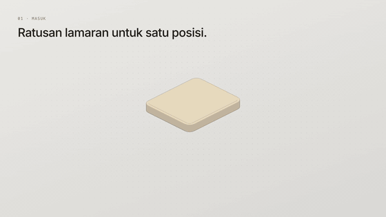
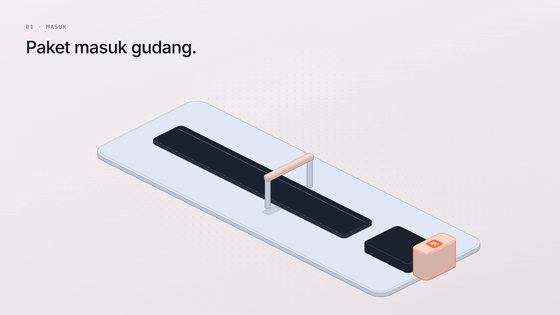
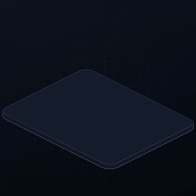

# isostory

A Claude Code skill for storytelling motion: isometric, coloured, branded stories that play on the web (autoplay, scroll-scrubbed, embeddable component) and render frame-exact to video (MP4, WebM, GIF, ProRes 4444 with alpha) in 16:9, 9:16 and 1:1 — with kinetic text, karaoke subtitles (+ SRT/VTT), logo decals and end cards.

Built on the [Hairline](https://github.com/lucasmarkes/hairline) kernel (MIT).

## Examples

Every clip below is one story file in [`examples/`](examples), rendered with `render.mjs` at 1080p. Click a preview for the full MP4.

| | |
|---|---|
| [](https://github.com/Resanso/isostory/releases/download/v0.1.0/hiring-16x9.mp4) | **Motion component · 16:9 · 19 s** — [`hiring.js`](examples/hiring.js)<br>Résumés pile up, get dealt onto a table, AIDA's bar scores them, the best five fold into cards and move down a hiring pipeline. Theme `paper`, logo printed on the table, chapters + pins, end card. |
| [](https://github.com/Resanso/isostory/releases/download/v0.1.0/logistics-16x9.mp4) | **Motion component · 16:9 · 14 s** — [`logistics.js`](examples/logistics.js) *(fictional brand)*<br>Parcels with the logo on every box ride a conveyor through a scanner gate and load into a truck. Theme `studio`, orange accent, lower-third, pins. |
| [](https://github.com/Resanso/isostory/releases/download/v0.1.0/fintech-ad-1x1.mp4) | **Video ad · 1:1 · 12 s** — [`fintech-ad.js`](examples/fintech-ad.js) *(fictional brand)*<br>Invoices rain down, fly into a phone and get paid while a counter runs, then cash-flow bars rise. Theme `midnight`, violet accent, `mask`/`pop`/`rise` text, karaoke subtitles + [SRT](https://github.com/Resanso/isostory/releases/download/v0.1.0/fintech-ad-1x1.srt). |
| [](https://github.com/Resanso/isostory/releases/download/v0.1.0/ad-hire-9x16.mp4) | **Video ad · 9:16 · 15 s** — [`ad.js`](examples/ad.js)<br>Cut to a 120 bpm grid: hook in the first second, a quote, a kinetic title with a highlighted word, a 0→92% stat, a lower-third, karaoke subtitles + [SRT](https://github.com/Resanso/isostory/releases/download/v0.1.0/ad-hire-9x16.srt), end card with CTA. |

The same story renders to any aspect: `--aspect 9:16,1:1,16:9`. Add `--alpha` for a transparent WebM + ProRes 4444 to lay over footage.

## Install

```sh
# into Claude Code's user skills
git clone https://github.com/Resanso/isostory ~/.claude/skills/isostory
# or, with the skills CLI
npx skills add Resanso/isostory
```

Then in Claude Code: `/isostory a 15s ad for … --logo ./logo.svg --accent #1b61ee`.

## Tools (run from your project folder)

| command | does |
|---|---|
| `node <skill>/build.mjs story.js --logo logo.svg` | a self-contained page with aspect/theme switches and a scroll demo |
| `node <skill>/look.mjs story.js --aspect 9:16,16:9,1:1` | contact sheets + checks (NaN, frame, text collisions, hook, held end) |
| `node <skill>/render.mjs story.js --aspect 9:16 --formats mp4,srt,poster` | video; `--alpha` for WebM-alpha + ProRes 4444; `--audio track.mp3` |

Needs Node 18+, and ffmpeg for `render.mjs`. `look`/`render` install `playwright-core` once into your user cache and drive your Chrome.

## Files

- `SKILL.md` — the workflow Claude follows
- `rules.md` — story, motion, colour, text and brand rules
- `isostory.js` — engine + player (API index at the top)
- `kernel.js` — Hairline kernel
- `examples/` — `hiring.js`, `logistics.js` (motion components), `fintech-ad.js`, `ad.js` (ads), `logos/` (fictional logos for the demos)
- `embed.md` — React/Next and plain-HTML embedding
