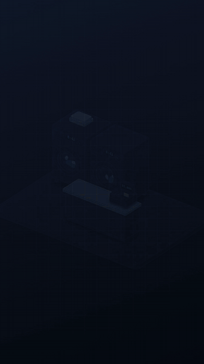

# isostory

A Claude Code skill for storytelling motion: isometric, coloured, branded stories that play on the web (autoplay, scroll-scrubbed, embeddable component) and render frame-exact to video (MP4, WebM, GIF, ProRes 4444 with alpha) in 16:9, 9:16 and 1:1 — with kinetic text, karaoke subtitles (+ SRT/VTT), logo decals and end cards.

Built on the [Hairline](https://github.com/lucasmarkes/hairline) kernel (MIT). Anatomy mode uses the [Anatomy](https://github.com/wheresryan22/anatomy) kit (MIT).

## Examples

Every clip below is one story file in [`examples/`](examples), rendered with `render.mjs` at 1080p, 30 fps.

### Motion component · 16:9 · 19 s — [`hiring.js`](examples/hiring.js)

Résumés pile up, get dealt onto a table, AIDA's bar scores them, the best five fold into cards and move down a hiring pipeline. Theme `paper`, logo printed on the table, chapters + pins, end card.

https://github.com/user-attachments/assets/e9bea4f7-5b78-4d4a-825c-7dbecdc80ed8

### Motion component · 16:9 · 14 s — [`logistics.js`](examples/logistics.js) *(fictional brand)*

Parcels with the logo on every box ride a conveyor through a scanner gate and load into a truck built from parts (six `cyl` wheels, a railed bed, cab, glass, headlights). Theme `studio`, orange accent, lower-third, pins.

https://github.com/user-attachments/assets/fc2f5130-928d-4cfc-ab0c-fc844adddce2

### Video ad · 1:1 · 12 s — [`fintech-ad.js`](examples/fintech-ad.js) *(fictional brand)*

Invoices rain down, fly into a phone and get paid while a counter runs, then cash-flow bars rise. Theme `midnight`, violet accent, `mask` / `pop` / `rise` text, karaoke subtitles + [SRT](https://github.com/Resanso/isostory/releases/download/v0.1.0/fintech-ad-1x1.srt).

https://github.com/user-attachments/assets/83c7fb09-1412-44cf-9cf6-5d30d1de89fd

### Video ad · 9:16 · 15 s — [`ad.js`](examples/ad.js)

Cut to a 120 bpm grid: hook in the first second, a quote, a kinetic title with a highlighted word, a 0→92% stat, a lower-third, karaoke subtitles + [SRT](https://github.com/Resanso/isostory/releases/download/v0.1.0/ad-hire-9x16.srt), end card with CTA.

https://github.com/user-attachments/assets/735c0902-d492-4d5b-b0d2-8dbddcd61566

The same story renders to any aspect: `--aspect 9:16,1:1,16:9`. Add `--alpha` for a transparent WebM + ProRes 4444 to lay over footage. MP4s, SRTs and posters are also on the [v0.1.0 release](https://github.com/Resanso/isostory/releases/tag/v0.1.0).

## Anatomy mode

For stories whose objects must be recognised at a glance — a washing machine with a turning drum, a cash register whose drawer opens, a courier scooter, a row of shop-houses — anatomy mode draws them with the [Anatomy](https://github.com/wheresryan22/anatomy) kit (MIT, vendored): four-tone solids built from many small parts (bevels, knurls, screws, glass, hoses), placed in scenes on a [Remotion](https://www.remotion.dev) stage that renders frame-exact to video, with the same kinetic titles, karaoke subtitles, end card and an optional ElevenLabs voice-over. Guide: [`anatomy/anatomy.md`](anatomy/anatomy.md).

### Video ad · 9:16 · 30 s · Indonesian voice-over — [`laundrybob/story.js`](anatomy/examples/laundrybob/story.js)

Five scenes for a laundry-management platform: receipts vanish off a counter, a cash drawer leaks notes, rival apps' branch links break, bags get QR tags and hop washer → iron → shelf, every branch wires into one dashboard, and a courier rides a GPS route to a WhatsApp "Tiba ✓". [MP4 9:16](https://github.com/Resanso/isostory/releases/download/v0.2.0/laundrybob-9x16.mp4) · [1:1](https://github.com/Resanso/isostory/releases/download/v0.2.0/laundrybob-1x1.mp4) · [16:9](https://github.com/Resanso/isostory/releases/download/v0.2.0/laundrybob-16x9.mp4) · [SRT](https://github.com/Resanso/isostory/releases/download/v0.2.0/laundrybob-9x16.srt)



### Motion component · 16:9 · 12 s — [`courier/story.js`](anatomy/examples/courier/story.js)

A small city lands block by block; the courier scooter (rebuilt per frame as it turns) rides the road under a pulsing GPS pin while the route lights up behind it, and the customer's phone gets "Delivered ✓". [MP4 16:9](https://github.com/Resanso/isostory/releases/download/v0.2.0/courier-16x9.mp4) · [9:16](https://github.com/Resanso/isostory/releases/download/v0.2.0/courier-9x16.mp4)


### Product loop · 1:1 · 10 s — [`washer/story.js`](anatomy/examples/washer/story.js)

One front-loader (≈60 parts: drawer, LCD in a recess, knurled knob, door ring with glass, a drum that spins up, drain hose, towels); the LCD counts down to DONE and a phone pings "Ready ✓". [MP4](https://github.com/Resanso/isostory/releases/download/v0.2.0/washer-1x1.mp4)


```sh
node ~/.claude/skills/isostory/anatomy/new.mjs my-story --example courier   # template + example + npm install
cd my-story && node look.mjs && node render.mjs --formats mp4,gif,srt,poster
```

## Install

```sh
# into Claude Code's user skills
git clone https://github.com/Resanso/isostory ~/.claude/skills/isostory
# or, with the skills CLI
npx skills add Resanso/isostory
```

Then in Claude Code: `/isostory a 15s ad for … --logo ./logo.svg --accent #1b61ee`.

## Tools (run from your project folder)

| command | does |
|---|---|
| `node <skill>/build.mjs story.js --logo logo.svg` | a self-contained page with aspect/theme switches and a scroll demo |
| `node <skill>/look.mjs story.js --aspect 9:16,16:9,1:1` | contact sheets + checks (NaN, frame, text collisions, hook, held end) |
| `node <skill>/render.mjs story.js --aspect 9:16 --formats mp4,srt,poster` | video; `--alpha` for WebM-alpha + ProRes 4444; `--audio track.mp3` |

Anatomy mode, from a project made by `anatomy/new.mjs`:

| command | does |
|---|---|
| `node look.mjs [--aspect 9:16,1:1,16:9] [--at 1.2,4.5]` | contact sheets + browser-error check |
| `ELEVENLABS_API_KEY=… node vo.mjs <voiceId>` | voice-over: one clip per subtitle window, laid on the timeline |
| `node render.mjs [--formats mp4,gif,srt,poster]` | video (+ GIF preview, SRT, poster) per aspect |

Needs Node 18+ (anatomy mode: Node 20+ and Chrome, which Remotion downloads), and ffmpeg for `render.mjs`. `look`/`render` install `playwright-core` once into your user cache and drive your Chrome.

## Files

- `SKILL.md` — the workflow Claude follows
- `rules.md` — story, motion, colour, text and brand rules
- `isostory.js` — engine + player (API index at the top)
- `kernel.js` — Hairline kernel
- `examples/` — `hiring.js`, `logistics.js` (motion components), `fintech-ad.js`, `ad.js` (ads), `logos/` (fictional logos for the demos)
- `embed.md` — React/Next and plain-HTML embedding
- `anatomy/` — anatomy mode: `anatomy.md` (guide), `new.mjs` (start a project), `template/` (Remotion stage, vendored Anatomy kit, object library: washer, shop props, city, scooter; `look`/`render`/`vo` tools), `examples/` (`laundrybob`, `courier`, `washer`)
- `media/` — README previews
